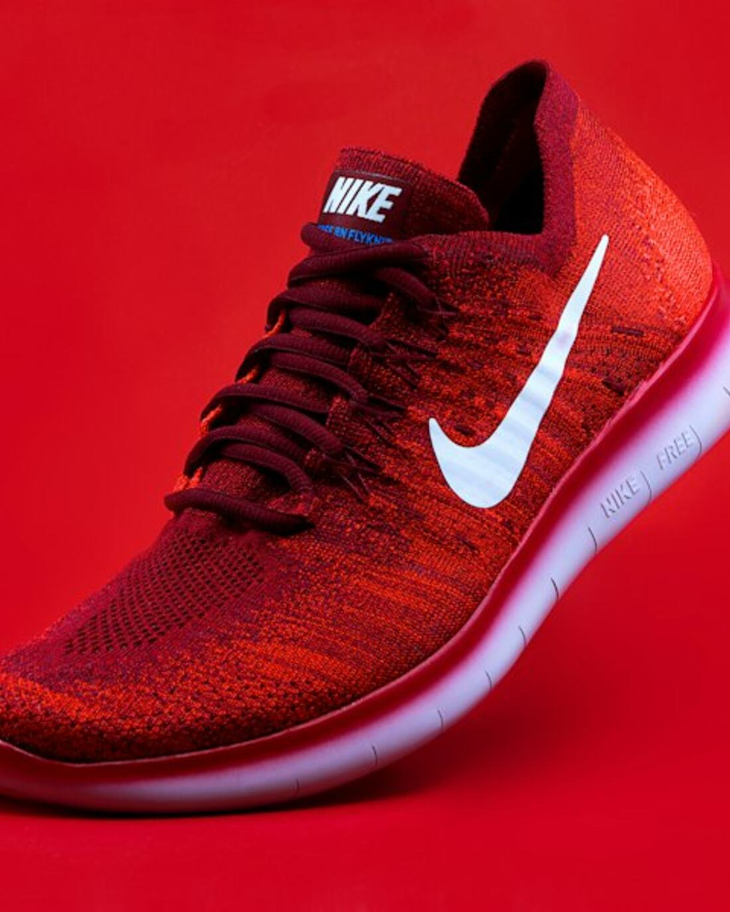

# NIKE — Air You Can Feel

A front-end-only sneaker store. No backend, no database, no build step — just HTML, CSS and vanilla JavaScript, ready to publish on GitHub Pages.



## Features

- Editorial hero with animated badge and floating product card
- 8-product catalogue rendered from a single data array (change `PRODUCTS` in `app.js` to edit the shop)
- Category filtering, live search with suggestions, empty state
- Product quick view: colourway, size grid with sold-out sizes, quantity, detail views, accordions
- Shopping bag drawer: quantities, remove, subtotal, free-shipping progress
- Wishlist panel with saved pairs
- Bag and wishlist persist in `localStorage`
- Newsletter validation, toast notifications
- Accessible: keyboard support, focus styles, `Esc` to close, ARIA state on every control
- Responsive down to 320px, with `prefers-reduced-motion` support

## Structure

```
index.html        markup for every section, drawer and modal
styles.css        design tokens + all styling
app.js            product data, rendering, cart/wishlist state
assets/           optimized photos (hero, editorial, product shots)
```

## Run locally

Any static server works:

```bash
python3 -m http.server 8000
# open http://localhost:8000
```

## Publish on GitHub Pages

1. Create a repository and push this folder:
   ```bash
   git init
   git add .
   git commit -m "Nike storefront demo"
   git branch -M main
   git remote add origin https://github.com/<your-user>/<repo>.git
   git push -u origin main
   ```
2. On GitHub: **Settings → Pages → Build and deployment**
3. Source: **Deploy from a branch**, branch **main**, folder **/(root)** → **Save**
4. The site goes live at `https://<your-user>.github.io/<repo>/` within a minute.

Because all paths are relative, the site also works from a subdirectory or any other static host.

## Notes

- Product photos come from Unsplash; this is a design demo and is not affiliated with Nike, Inc.
- Checkout is intentionally not connected — it shows a demo toast.
- Prices, sizes and stock are hard-coded sample data.
